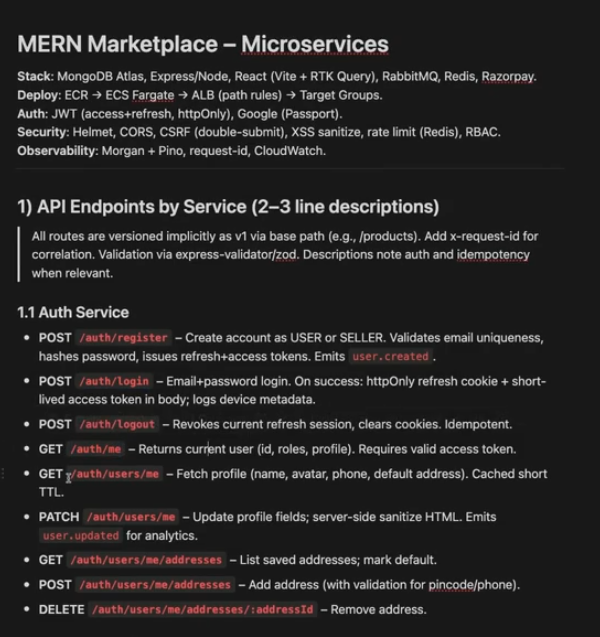

History Window Help
<
Cohort online market place
Cohort online market place Private
+
Edited 3h ago Share
MERN Marketplace - Microservices
Stack: MongoDB Atlas, Express/Node, React (Vite + RTK Query), RabbitMQ, Redis, Razorpay.
Deploy: ECR → ECS Fargate → ALB (path rules) → Target Groups.
Auth: JWT (access+refresh, httpOnly), Google (Passport).
Security: Helmet, CORS, CSRF (double-submit), XSS sanitize, rate limit (Redis), RBAC.
Observability: Morgan + Pino, request-id, CloudWatch.
1) API Endpoints by Service (2-3 line descriptions)
All routes are versioned implicitly as v1 via base path (e.g., /products). Add x-request-id for correlation. Validation via express-validator/zod. Descriptions note auth and idempotency when relevant.
1.1 Auth Service
POST/auth/register-Create account as USER or SELLER. Validates email uniqueness, hashes password, issues refresh+access tokens. Emits user.created.
POST/auth/loginEmail+password login. On success: httpOnly refresh cookie + short-lived access token in body; logs device metadata.
POST/auth/Logout-Revokes current refresh session, clears cookies. Idempotent.
GET /auth/ne-Returns current user (id, roles, profile). Requires valid access token.
GET /auth/users/me - Fetch profile (name, avatar, phone, default address). Cached short TTL
PATCH/auth/users/me-Update profile fields; server-side sanitize HTML. Emits user.updated for analytics.
GET /auth/users/me/addresses-List saved addresses; mark default.
POST/auth/users/me/addresses - Add address (with validation for pincode/phone).
DELETE/auth/users/me/addresses/:addressId-Remove address.
1.2 Product Service
GET /products-Catalog listing with search (text index), filters (category, price range), pagination, sort.
GET/products/sid-Product details, images, seller info (via populate). Cacheable by id.
QSat Sep 6 9:23PM